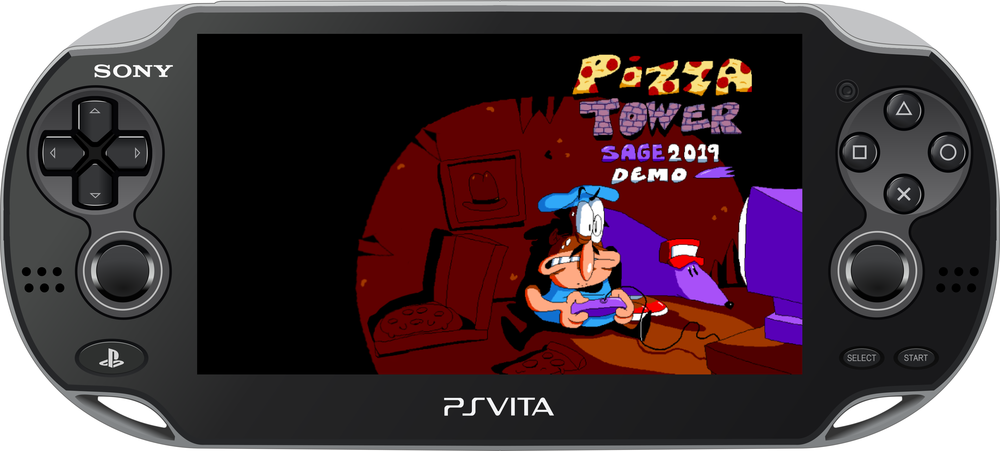
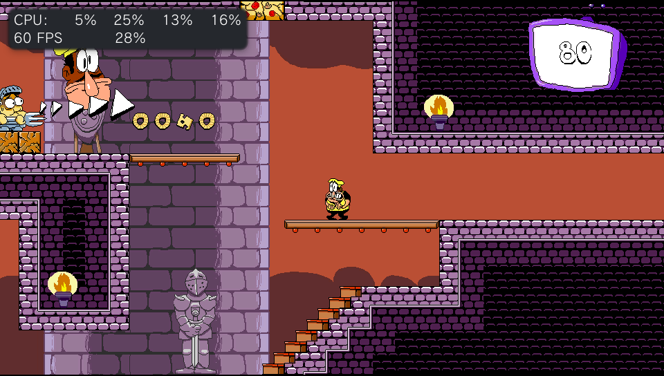
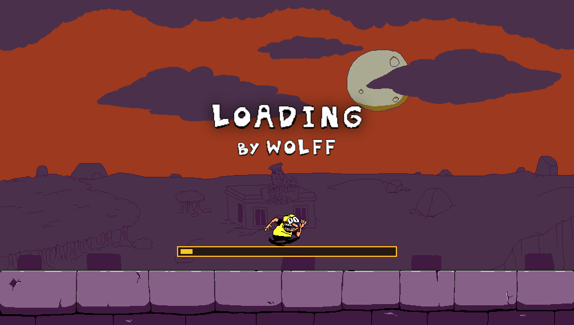
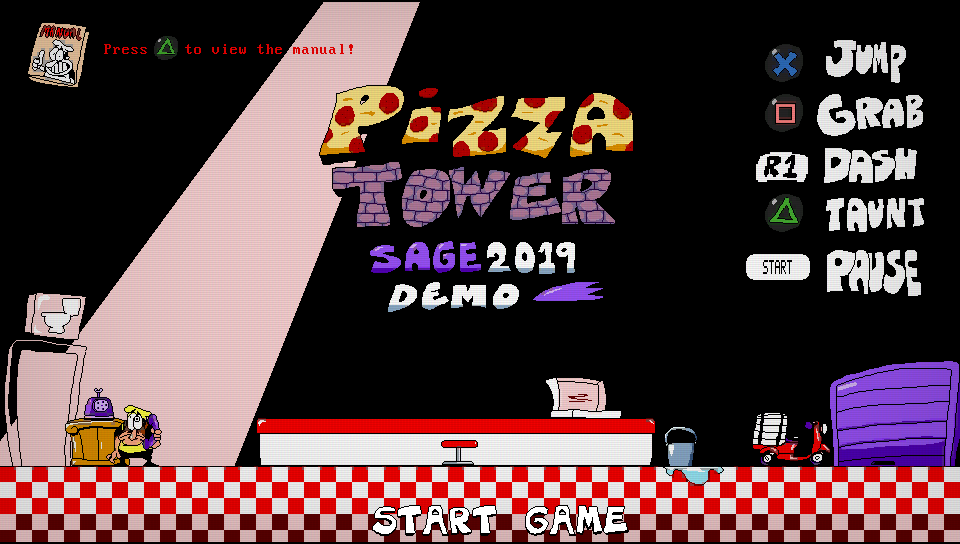
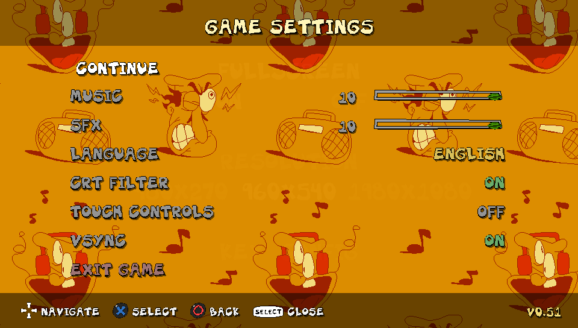
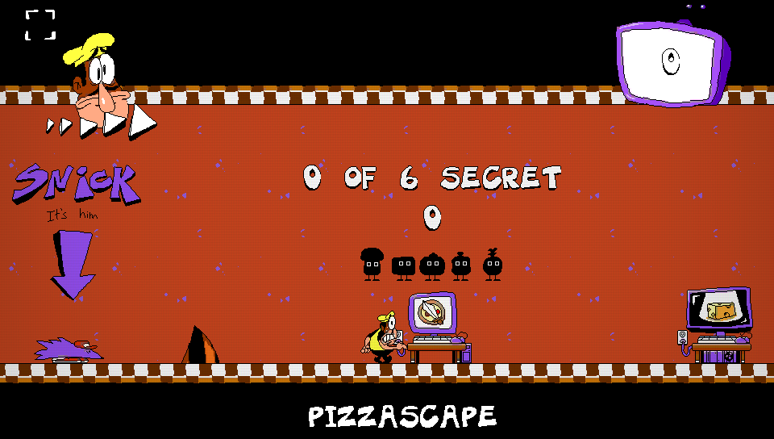
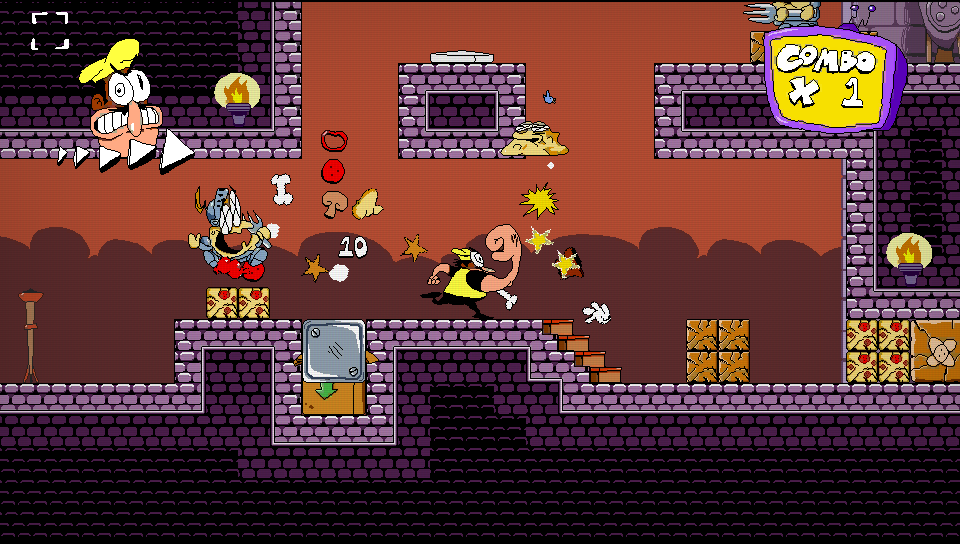

<p align="center">
  
</p>

<p align="center">
  An unofficial port of <strong>Pizza Tower SAGE 2019 Demo (v14)</strong> for the PlayStation Vita.
</p>

<p align="center">
  
</p>

<p align="center">
  <a href="https://github.com/WolffsRoom/PizzaTowerSage2019Vita/releases">Releases</a> ·
  <a href="https://github.com/WolffsRoom/PizzaTowerSage2019Vita/issues">Report an issue</a> ·
  <a href="https://github.com/ButterscotchRunner/Butterscotch">Butterscotch</a>
</p>

PizzaTowerSage2019Vita runs the official Windows GameMaker data of the famous SAGE 2019 demo through a specialized, Vita-focused version of [Butterscotch](https://github.com/ButterscotchRunner/Butterscotch), using [VitaGL](https://github.com/Rinnegatamante/vitaGL) and the Modern-GL renderer. The port adds native PlayStation Vita controls with official PlayStation glyphs, memory-safe OpenAL audio streaming, GPU texture preloading, SGX543-compliant palette swapping shaders, and numerous gameplay and engine bug fixes.

> [!IMPORTANT]
> This repository and its releases do **not** include Pizza Tower's proprietary game data. You must obtain the free demo from the official [Pizza Tower Demo by PizzaTowerGuy](https://pizzatowerguy.itch.io/pizza-tower-demo). The VPK cannot run by itself: the user's `data.win` must be copied to the Vita.

## Project Status

<div align="center">
  <a href="https://github.com/WolffsRoom/PizzaTowerSage2019Vita/releases"></a>
  <a href="https://github.com/WolffsRoom/PizzaTowerSage2019Vita/releases/latest"></a>
  <br>
  
  <a href="https://pizzatowerguy.itch.io/pizza-tower-demo"></a>
  
</div>

---

The current release build is **v0.55**, based on the Windows **SAGE 2019 Demo (v14)**. It is fully playable from start to finish on real PlayStation Vita hardware at a rock-solid 60 FPS.

Explore all three stages from the original SAGE 2019 Demo. Complete them all to unlock a secret bonus challenge: **Snick's Challenge**!
- **Pizzascape** (Medieval)
- **Ancient Cheese** (Ancient)
- **Bloodsauce Dungeon** (Dungeon)

**Bonus Stage:** Snick's Challenge — A timed challenge combining all three stages!

**Working in the current build:**
- Complete Hub world, secret areas, Pizza Time countdown, and rank tallying;
- Rock-solid 60 FPS gameplay accelerated by VitaGL hardware rendering;
- Physical Vita controls mapped to native gamepad inputs with custom PlayStation glyphs;
- Lazy OpenAL audio streaming for all 91 sound effects and music tracks without RAM exhaustion;
- Overhauled settings menu with clean font rendering;
- Dedicated LiveArea presence with custom icon, splash screen, and digital manual.

---

## Screenshots

<p align="center">
  
  
</p>

<p align="center">
  
  
</p>

<p align="center">
  
  
</p>

---

## Controls

Pizza Tower SAGE recognizes the PlayStation Vita as a native gamepad controller. Prompts and button layouts have been adapted specifically for the handheld layout.

<div align="center">

| PS Vita Input | Glyph | Game / Runtime Input | Action |
| :--- | :---: | :--- | :--- |
| **D-Pad / Left Stick** |  | Directional input (`vk_left`/`vk_right`/`vk_up`/`vk_down`) | Move Peppino, duck, look up, navigate menus |
| **Cross** |  | Gamepad Face 1 / `Z` fallback | Jump, confirm in menus, release Super Jump |
| **Square** |  | Gamepad Face 3 / `Shift` fallback | Mach Dash / Run, accelerate |
| **Circle** |  | Gamepad Face 2 / `X` fallback | Grab / Dash Attack, cancel in menus |
| **Triangle** |  | Gamepad Face 4 / `C` fallback | Taunt / Parry, breakdance |
| **L / L1** |  | Left Shoulder / `Ctrl` fallback | Shoulder dash / auxiliary shoulder action |
| **R / R1** |  | Right Shoulder / `Shift` fallback | Shoulder dash / auxiliary shoulder action |
| **Start** |  | Gamepad Start / `Escape` fallback | Pause / resume gameplay, open pause overlay |
| **Select** |  | Gamepad Select / `Enter` fallback | Auxiliary select / options confirmation |

</div>

---

## Changes and Improvements over Original PC Demo

Based on the development documentation and hardware testing logs, multiple enhancements, optimizations, and bug fixes were engineered to bring the original PC/itch.io demonstration to the PS Vita:

### 1. Isolated Application Environment and Title ID (`PTSAGE001`)
* **Dedicated Title ID**: Configured with Title ID `PTSAGE001` so that the SAGE demo lives entirely side-by-side with the full game port (`PTWVITA01`) without overwriting save files, configurations, or texture caches.
* **Separated Data Directory**: All runtime data is organized cleanly under `ux0:data/pizzatowersage/`:
  * Game data: `ux0:data/pizzatowersage/data.win`
  * Configurations: `ux0:data/pizzatowersage/config.ini`
  * Saved games: `ux0:data/pizzatowersage/save/`
  * Execution log: `ux0:data/pizzatowersage/pizzatowersage.log`
* **Custom LiveArea Integration**: Includes dedicated assets (`icon0.png`, `pic0.png`, `bg0.png`, `startup.png`) and an interactive digital manual explaining game mechanics.

### 2. On-Demand Lazy Audio Streaming
* **Problem in Original**: The PC release loaded ~275 MB of uncompressed WAV files (91 audio tracks and effects) into RAM upon startup. On the PlayStation Vita, this immediately exhausts the memory pool and causes hard crashes.
* **Solution**: Developed a streaming audio pipeline in OpenAL that parses the `AUDO` data chunk dynamically. Audio data is streamed on demand rather than bulk-loaded into system RAM.
* **RIFF Subchunk Sanitization**: Implemented robust header filtering to ignore non-audio metadata blocks (such as `LIST` info chunks), eliminating high-pitched digital chirping artifacts.

### 3. GPU Texture Cache and Preloading
* **Texture Preparation**: Prepared hardware-accelerated GPU textures (PVR/BC3 DXT5 and RGBA4444) across all 35 demo texture pages.
* **Eviction Protection**: Essential UI elements, fonts, HUD elements, and player animation pages are protected from aggressive eviction, avoiding frame drops when traversing rooms.

### 4. SGX543-Compliant Palette Swap Shader (`pal_swapper`)
* **Problem in Original**: The original GameMaker Studio shader used dynamic float-based loop iteration (`for (float i = ...)`), which is forbidden by the PowerVR SGX543 GLSL ES 1.00 compiler specification.
* **Solution**: Re-engineered `pal_swapper` with integer loops and normalized texture coordinate lookups. Peppino's palette swaps (clothes, outfits) and transformation visual effects now render authentically.

### 5. Super Jump and Input Engine Overhaul
* **Super Jump Launch (`scr_player_Sjumpprep`)**: In the original PC GameMaker code, launching a charged Super Jump strictly checked for `!key_up` (releasing Up). On console/handheld controllers, players instinctively hit **Cross (Jump)** or release the stick. If Up was held while pressing Jump, Peppino remained permanently stuck in the crouched charging animation. The Vita runner now releases `key_up` and launches the jump upon pressing **Cross**, with a fail-safe state transition to `scr_player_Sjump` (State 62).
* **Analog Deadzone Calibration**: Fixed an issue in `scr_getinput` where slight analog stick resting variance caused unintended vertical input, locking Peppino in ducking or crawling animations.

### 6. Modern Options Menu and Font Atlas Cleanup
* **Menu Unfreeze Fix**: In the PC version, opening Options set `selected = 1` in `obj_mainmenuselect`. When closing the custom settings menu, `selected` was left locked, permanently freezing main menu navigation. The runner now cleanly resets cursor control.
* **Font Atlas Polish**: Cleaned up [assets/ui/options_font.png](assets/ui/options_font.png), eliminating dark rectangular backgrounds (`RGB(30, 30, 40)`) and removing debug index numbers rendered on top of glyphs ($y < 17$), leaving crisp white letters with clear black borders.

### 7. Pizza Time Panic and Camera Fixes
* **Panic Zoom Adjustment**: Normalized camera scaling during the "Pizza Time" escape sequence to avoid HUD clipping and display distortion on the Vita screen.
* **Mini-Pillar Masks**: Fixed collision mask toggling for `obj_reverseminipillar` during escape mode (`global.panic == 1`).

### 8. GMS 2.2 Compatibility Layer
* Implemented built-in functions introduced in GameMaker Studio 2.2 used by the demo: `layer_sprite_change`, `layer_background_get_*`, `layer_tile_destroy`, `gpu_set_texfilter_ext`, `surface_getpixel`, and `sprite_duplicate`.

---

## Requirements

- A PlayStation Vita running HENkaku / Enso on firmware 3.60 or 3.65;
- [kubridge](https://github.com/bythos14/kubridge) plugin installed;
- [FdFix](https://github.com/TheOfficialFloW/FdFix) plugin installed (or equivalent rePatch file-descriptor handling);
- `libshacccg.suprx` runtime shader compiler installed (using ShaRKBR3ED / VitaDB);
- The free **Pizza Tower SAGE 2019 Demo (v14)** downloaded from [Pizza Tower Demo by PizzaTowerGuy](https://pizzatowerguy.itch.io/pizza-tower-demo).

---

## Download Instructions

You will need both the Vita port VPK and the original PC demo game files:

<div align="center">

| File | Description | Source |
| :--- | :--- | :---: |
| **`PizzaTowerSAGE-v0.55.vpk`** | Handheld port executable and runtime assets for the PS Vita. | [Download VPK](https://github.com/WolffsRoom/PizzaTowerSage2019Vita/releases/latest) |
| **`data.win`** | Original GameMaker game data extracted from the free PC demo. | [Pizza Tower Demo by PizzaTowerGuy](https://pizzatowerguy.itch.io/pizza-tower-demo) |

</div>

### Step-by-Step Guide:
1. **Download the Port:** Grab the latest `PizzaTowerSAGE-v0.55.vpk` from [GitHub Releases](https://github.com/WolffsRoom/PizzaTowerSage2019Vita/releases/latest).
2. **Download the Game Data:** Visit [Pizza Tower Demo by PizzaTowerGuy](https://pizzatowerguy.itch.io/pizza-tower-demo) on itch.io and download the free demo package.
3. **Extract `data.win`:** Unzip the downloaded file on your computer and locate `data.win`.

---

## Installation Guide

1. Install `PizzaTowerSAGE-v0.55.vpk` on your PS Vita using **VitaShell**.
2. Connect your PS Vita to your PC (via USB or FTP in VitaShell).
3. Ensure the folder `ux0:data/pizzatowersage/` exists on your Vita memory card. If not, create it.
4. Copy the extracted `data.win` file to:
   ```text
   ux0:data/pizzatowersage/data.win
   ```
5. Close VitaShell and launch **Pizza Tower SAGE 2019** directly from the LiveArea!

---

## Building from Source

To compile the PlayStation Vita executable and package the VPK using the VitaSDK container:

```powershell
./scripts/build-pizzatowersage-gl.ps1
```

The output VPK will be generated in:
```text
artifacts/current/PizzaTowerSAGE-v0.55.vpk
```

---

## Technology Stack

```text
Official SAGE 2019 Demo data.win (PC/itch.io)
                      ↓
          Lazy OpenAL Audio Parser
                      ↓
       Custom Butterscotch Vita Runner
                      ↓
     GameMaker VM, Objects, GML Scripts
                      ↓
   VitaGL Modern-GL (PowerVR SGX543)
                      ↓
   PlayStation Vita Display and Controls
```

PizzaTowerSage2019Vita does not emulate Windows and does not execute the PC binary. It natively interprets the GameMaker bytecode through an optimized C/C++ runner.

---

## Credits

- **[Tour De Pizza](https://twitter.com/PizzaTowerGame)** - creators of Pizza Tower.
- **[SAGE](https://sonicfangameshq.com/SAGE/)** - Sonic Amateur Games Expo for hosting the legendary 2019 demo showcase.
- **[Butterscotch](https://github.com/ButterscotchRunner/Butterscotch)** and contributors - open-source GameMaker runner foundation.
- **[VitaGL](https://github.com/Rinnegatamante/vitaGL)** by Rinnegatamante - OpenGL acceleration for PS Vita.
- **[VitaSDK](https://vitasdk.org/)** and the PlayStation Vita homebrew development community.
- **[UndertaleModTool](https://github.com/UnderminersTeam/UndertaleModTool)** - bytecode analysis and data validation.

Gemini 4 Argon was used as a development assistant for diagnostics, implementation support, project organization and technical documentation. All changes remain subject to project review and real-hardware testing.

---

## License and Legal Notice

Butterscotch is distributed under the Mozilla Public License 2.0. Modified source files remain available under the same license, with their original notices preserved.

Pizza Tower, Peppino Spaghetti, characters, audio, and game assets are the intellectual property of Tour De Pizza. This is an unofficial, non-commercial fan port, not affiliated with or endorsed by Tour De Pizza. It does not distribute proprietary game assets.
